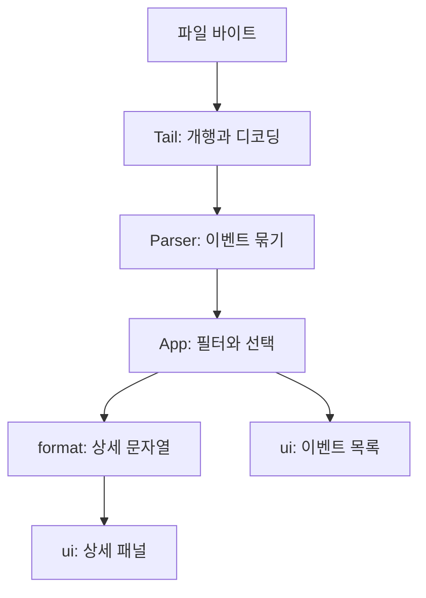

# rust_toy Rust 개발 가이드

`hotkey`의 TOML 파서와 `logwatch`의 로그 파서부터 읽으면 Rust의 타입, 소유권, 오류 처리에 익숙해질 수 있습니다. 그다음 파일 읽기와 화면 처리, Windows API 연동으로 넘어갑니다.

## 목차

1. [빌드하고 실행하기](#1-빌드하고-실행하기)
2. [소유권과 빌림](#2-소유권과-빌림)
3. [Option과 Result](#3-option과-result)
4. [모듈 구조와 플랫폼 분기](#4-모듈-구조와-플랫폼-분기)
5. [Hotkeys 코드 따라가기](#5-hotkeys-코드-따라가기)
6. [Logwatch 코드 따라가기](#6-logwatch-코드-따라가기)
7. [테스트와 디버깅](#7-테스트와-디버깅)
8. [연습 과제](#8-연습-과제)

## 1. 빌드하고 실행하기

각 폴더가 독립 Cargo 패키지입니다. 아래 명령은 저장소 루트에서 PowerShell을 기준으로 실행합니다. `logwatch`는 Rust 2024 에디션과 `if` 안의 `let` 연결 구문을 사용하므로 최신 stable 툴체인으로 시작하세요.

```powershell
rustc --version
cargo --version

Push-Location logwatch
cargo run --locked -- --dump
cargo run --locked
Pop-Location
```

첫 명령은 예제 로그를 한 번 읽어 표준 출력에 표시합니다. 두 번째 명령은 대화형 터미널 UI를 엽니다. `cargo run`의 `--` 뒤에 적은 값은 Cargo가 실행 파일에 전달합니다. Logwatch의 기본 설정과 로그 경로는 현재 작업 폴더의 영향을 받습니다.

```powershell
# Windows x64에서 실행
Push-Location hotkey
cargo build --locked --release --target x86_64-pc-windows-msvc
Copy-Item .\hotkeys.toml .\target\x86_64-pc-windows-msvc\release\
.\target\x86_64-pc-windows-msvc\release\hotkeys.exe
Pop-Location
```

Hotkeys는 실행 파일 옆의 `hotkeys.toml`을 읽습니다. 알림 영역 아이콘에서 설정을 열고, 저장한 뒤 앱을 다시 실행하면 바뀐 설정이 적용됩니다. MSVC 대상의 실행 파일을 빌드하려면 Windows용 MSVC C++ 빌드 도구와 Windows SDK가 필요합니다.

| 파일 또는 명령 | 역할 |
|---|---|
| `Cargo.toml` | 패키지 이름, 에디션, 의존성과 기능 지정 |
| `Cargo.lock` | 의존성의 해석 결과 기록. `--locked`로 잠금 파일 갱신이 필요한 빌드를 실패 처리 |
| `cargo check` | 실행 파일 링크 없이 컴파일과 타입 검사 |
| `cargo test` | 구성된 단위·통합·문서 테스트 실행 |
| `cargo build --release` | 최적화된 배포용 빌드 |

## 2. 소유권과 빌림

Java에서 객체 참조를 넘기던 부분을 Rust에서는 누가 소유하고 누가 잠시 빌리는지로 나눠 읽으면 됩니다.

| 타입 또는 표현 | 실제 코드에서 읽는 법 |
|---|---|
| `String` | 문자열을 소유합니다. `LogEvent.raw`는 파일 읽기를 마친 뒤에도 보관됩니다. |
| `&str` | UTF-8 문자열의 일부를 읽기 전용으로 빌립니다. `Parser::push`는 호출자가 가진 한 줄을 빌립니다. |
| `&mut self` | 메서드가 객체를 배타적으로 빌려 상태를 수정합니다. `Parser::push` 내부의 `back_mut()`로 마지막 이벤트를 수정합니다. |
| `&[u8]` | 바이트 구간을 빌립니다. `Tail::consume`은 실제로 읽은 버퍼의 일부만 받습니다. |
| `Option<&LogEvent>` | 값이 있으면 내부 이벤트를 빌립니다. `App::selected_event`는 조회할 때 이벤트를 복사하지 않습니다. |

[`logwatch/src/main.rs`](logwatch/src/main.rs)의 이 반복문에서는 `batch.lines`에 들어 있던 `String`이 각 반복의 `line`으로 이동합니다.

```rust
for (number, line) in batch.lines {
    parser.push(&line, number, tail.generation);
}
```

`push`는 호출 중에만 `line`을 빌립니다. [`parser.rs`](logwatch/src/parser.rs)의 `line.to_string()`과 `event.raw.push_str(line)`으로 보관할 바이트를 복사하므로 반복이 끝나 `line`이 해제돼도 이벤트는 유지됩니다.

[`hotkey/src/config.rs`](hotkey/src/config.rs)의 `for entry in config.hotkeys`는 항목을 소유한 채 순회합니다. `match (entry.text, entry.send)`에서 꺼낸 문자열을 `Action::Text(text)`로 옮길 수 있습니다. `Chord`는 정수 필드만 있고 `Copy`를 파생하므로 값을 대입해도 원래 변수를 계속 사용할 수 있습니다.

문자열의 `len()`은 바이트 길이입니다. 예를 들어 `"한글".len()`은 6이고 `"한글".chars().count()`는 2입니다. `Tail`의 용량 제한과 `format::xml_end`의 위치가 바이트 단위라는 점을 함께 확인하세요.

## 3. Option과 Result

| 표현 | 이 저장소의 예 |
|---|---|
| `Option<T>` | 값이 있을 수도 있습니다. `Entry.text`, `Entry.send`, 선택한 이벤트가 해당합니다. |
| `Result<T, E>` | 성공 값 또는 오류를 반환합니다. TOML 파싱, 파일 읽기, 정규식 생성이 해당합니다. |
| `?` | 성공 값을 꺼내고 실패하면 현재 함수에서 조기 반환합니다. `Option`에서는 `None`을 전파합니다. |
| `if let` | 관심 있는 패턴 하나만 골라 처리합니다. `if let Some(event) = self.events.back_mut()`가 예입니다. |
| `match` | 가능한 경우를 타입과 패턴에 따라 분기합니다. `Action::Text`와 `Action::Send`가 예입니다. |

Hotkeys의 `parse_chord`에서 키 코드가 있으면 `u16`을 얻고 없으면 어떤 조합이 잘못됐는지 반환합니다.

```rust
let key = key_code(&tokens.next().unwrap_or_default())
    .ok_or_else(|| format!("Invalid key in {source:?}"))?;
```

Logwatch의 `Tail::initial`은 파일 읽기 실패를 `?`로 보냅니다. 호출한 `main`이 `with_context`로 파일 경로를 덧붙입니다. 실행 도중의 `Tail::poll` 실패는 `App::poll`의 `match`에서 상태 메시지로 바꾸고 다음 주기에 다시 읽습니다. 테스트에서의 `unwrap()`은 실패 시 테스트 자체를 실패시키는 용도로 쓰입니다.

## 4. 모듈 구조와 플랫폼 분기

- [`hotkey/src/main.rs`](hotkey/src/main.rs)의 `#[cfg(windows)]`는 빌드 시 Windows용 진입점과 `windows_app` 모듈을 선택합니다. `#[cfg(any(windows, test))]` 덕분에 다른 OS에서도 설정 파서의 테스트를 실행할 수 있습니다.
- [`logwatch/src/lib.rs`](logwatch/src/lib.rs)의 `pub mod`는 모듈을 크레이트 외부에서 사용할 수 있게 합니다. 실행 파일과 [통합 테스트](logwatch/tests/behavior.rs)는 모두 `logwatch::parser::Parser`처럼 접근합니다.
- 모듈 첫 부분의 `//!`는 파일이나 모듈의 역할, 선언 바로 앞의 `///`는 함수나 타입의 계약, `//`는 구현 중 판단 근거를 설명합니다. `cargo doc --locked --no-deps`로 공개 모듈의 문서 페이지를 만들 수 있습니다.

## 5. Hotkeys 코드 따라가기

| 순서 | 파일과 심볼 | 확인할 내용 |
|---|---|---|
| 1 | [`main.rs`](hotkey/src/main.rs) → `windows_app::run` | 실행 파일 옆의 TOML을 읽고 오류가 나면 메시지 박스를 엽니다. |
| 2 | [`config.rs`](hotkey/src/config.rs) → `parse_chord` | `Ctrl+Alt+1`의 마지막 토큰을 주키로 쓰고 보조키는 비트 OR로 합칩니다. |
| 3 | [`config.rs`](hotkey/src/config.rs) → `parse` | `HashSet<Chord>`로 중복을 검사합니다. `text`와 `send` 중 하나만 받고, 전송 조합이 등록 트리거와 겹치는지도 검사합니다. |
| 4 | [`windows_app.rs`](hotkey/src/windows_app.rs) → `run_window` | 숨은 창을 만들고 `RegisterHotKey`에 ID를 등록한 뒤 메시지 루프에 진입합니다. |
| 5 | [`windows_app.rs`](hotkey/src/windows_app.rs) → `window_proc` | `WM_HOTKEY`에서 대기 입력을 저장합니다. `WM_TIMER`에서 키 해제와 포커스를 확인하고 입력을 보내거나 취소합니다. |
| 6 | [`windows_app.rs`](hotkey/src/windows_app.rs) → `send_action` | 텍스트는 UTF-16 코드 유닛, 단축키는 가상 키 누름·해제 배열로 구성합니다. |
| 7 | [`windows_app.rs`](hotkey/src/windows_app.rs) → `run_window` 후반 | 앞서 성공한 등록을 해제하고 상태 포인터, 아이콘과 창을 정리합니다. |

FFI 부분에서 `SetWindowLongPtrW`는 Rust 객체의 주소를 창에 저장합니다. 호출자의 스택에 있는 `State`가 메시지 루프 동안 살아 있고, 정리할 때 창에 연결한 주소를 지웁니다. `wide`는 Win32의 `W` 함수가 읽는 널 종료 UTF-16 배열을 만듭니다. `TrackPopupMenu`는 메시지를 다시 처리할 수 있으므로 메뉴를 열기 전에 설정 경로를 복제합니다.

## 6. Logwatch 코드 따라가기



| 파일과 심볼 | 확인할 내용 |
|---|---|
| [`main.rs`](logwatch/src/main.rs) · `Args`, `main` | 파일 인자 → 설정된 소스 경로 순으로 경로를 선택하고 `--dump`와 TUI를 분기합니다. |
| [`config.rs`](logwatch/src/config.rs) · `Config::load` | 생략한 필드는 기본값으로 채웁니다. 설정 파일 속 상대 경로는 TOML 파일의 부모 폴더를 기준으로 계산합니다. |
| [`tail.rs`](logwatch/src/tail.rs) · `initial`, `poll`, `consume` | 첫 읽기는 실제 줄 번호를 셉니다. 폴링은 마지막 위치부터 이어 읽고, 개행 전 바이트는 `pending`에 보관합니다. |
| [`parser.rs`](logwatch/src/parser.rs) · `push`, `boundary` | 시작 패턴의 새 줄은 이벤트를 만들고 다른 줄은 직전 이벤트의 본문에 붙입니다. 파일이 교체되면 기존 이벤트와 이어 붙이지 않습니다. |
| [`app.rs`](logwatch/src/app.rs) · `refresh`, `update_detail`, `key` | 필터 결과는 이벤트 ID로 저장합니다. ID나 원문 길이, 포맷 모드가 바뀌면 상세 문자열을 다시 계산합니다. |
| [`format.rs`](logwatch/src/format.rs) · `detail` | SQL은 들여쓰기를 바꾸고 XML은 첫 루트를 찾아 형식화합니다. 실패한 XML은 안내와 해당 텍스트를 함께 보여 줍니다. |
| [`ui.rs`](logwatch/src/ui.rs) · `draw` | 선택 ID를 목록 행으로 변환하고 터미널 폭과 스크롤에 맞춰 목록과 상세를 그립니다. |

예제 로그의 `req-001`을 따라 읽어 보세요. `Tail`이 원본 5~15행을 각 줄 번호와 함께 전달하면 `Parser`가 헤더에서 요청 ID를 꺼내고 그 아래의 SQL 및 파라미터 줄을 한 이벤트에 붙입니다. `/`로 검색하거나 `r`로 선택 이벤트의 요청 ID를 걸면 `App::refresh`가 표시할 ID를 골라냅니다. `v`를 누르면 `App::update_detail`이 원문 또는 포맷된 표시 문자열을 새로 얻습니다.

교체·잘림을 추적할 때는 `offset`(바이트 위치), `line`(파일 내 물리 줄 번호), `generation`(파일 세대), `LogEvent.id`(실행 중 이벤트 식별자)를 구분하세요. 파일 세대가 증가하면 파일 위치와 줄 번호는 초기화되지만 기존 이벤트와 단조 증가하는 ID는 파서에 남습니다. 이벤트가 보관 상한을 넘으면 `VecDeque`의 앞에서 오래된 것부터 제거합니다.

## 7. 테스트와 디버깅

저장소 루트에서 프로젝트별 테스트를 실행합니다.

```powershell
cargo test --locked --manifest-path hotkey/Cargo.toml
cargo test --locked --manifest-path logwatch/Cargo.toml
cargo test --locked --manifest-path logwatch/Cargo.toml --test behavior append_waits_for_complete_utf8_and_crlf
```

| 증상 또는 학습 포인트 | 먼저 볼 코드나 테스트 |
|---|---|
| 조합 문자열이 거절됨 | `hotkey/src/config.rs`의 `parse_chord` → `parse`, `accepts_unicode_text_and_rejects_conflicts` |
| 등록은 되지만 입력이 안 감 | `windows_app.rs`의 `WM_TIMER` → `keys_released` → `send_action`. Windows에서 일반 텍스트 편집기로 재현하며 활성 창이 바뀌는지도 확인 |
| 추가한 로그가 바로 안 보임 | `tail.rs`의 `consume`과 `pending`, `append_waits_for_complete_utf8_and_crlf` |
| 교체한 로그에서 파일 세대가 안 바뀜 | `Tail::poll`의 식별 정보·오프셋·앵커 비교, `same_length_overwrite_is_detected_by_anchor` |
| 로그 읽기와 화면 선택을 구분하고 싶음 | `hold_keeps_selection_while_ingestion_and_search_continue` |
| 터미널 없이 UI를 검증하고 싶음 | `render_wide_narrow_empty_and_detail_scrolling`의 `TestBackend`와 셀 검사 |

Logwatch의 디버그 출력은 먼저 `--dump`와 테스트에서 확인하세요. 실시간 화면이 전체 터미널을 사용하므로 UI 실행 도중 직접 `println!`을 추가하면 화면에 섞일 수 있습니다.

## 8. 연습 과제

1. **소유권** — 예제에서 `for entry in config.hotkeys`를 `for entry in &config.hotkeys`로 바꿔 `match (entry.text, entry.send)`가 왜 컴파일되지 않는지 확인하세요. 문자열을 옮기려는 코드가 어느 줄인지 찾아보세요.
2. **비트마스크와 `Option`** — `Ctrl+Shift+F5`를 손으로 파싱해 보세요. 최종 보조키는 `2 | 4`인 6, 주키는 `0x74`입니다. `Ctrl+Ctrl+F5`가 어느 분기에서 오류가 되는지 확인하세요.
3. **멀티라인 로그** — 예제 파일을 복사하고, 기존 ERROR 메시지 뒤에 `Caused by:` 줄과 새 타임스탬프 헤더를 추가하세요. `--dump`에서 각 출력의 lines 범위를 비교하고 어느 줄에서 Parser가 새 이벤트를 만드는지 코드를 따라가 보세요.
4. **테스트 작성** — `same_length_overwrite_is_detected_by_anchor`를 읽고 `Batch.reset`, 새 줄 번호, `Tail.generation` 중 현재 테스트가 검사하는 값과 추가로 검사할 값을 구분해 보세요.
